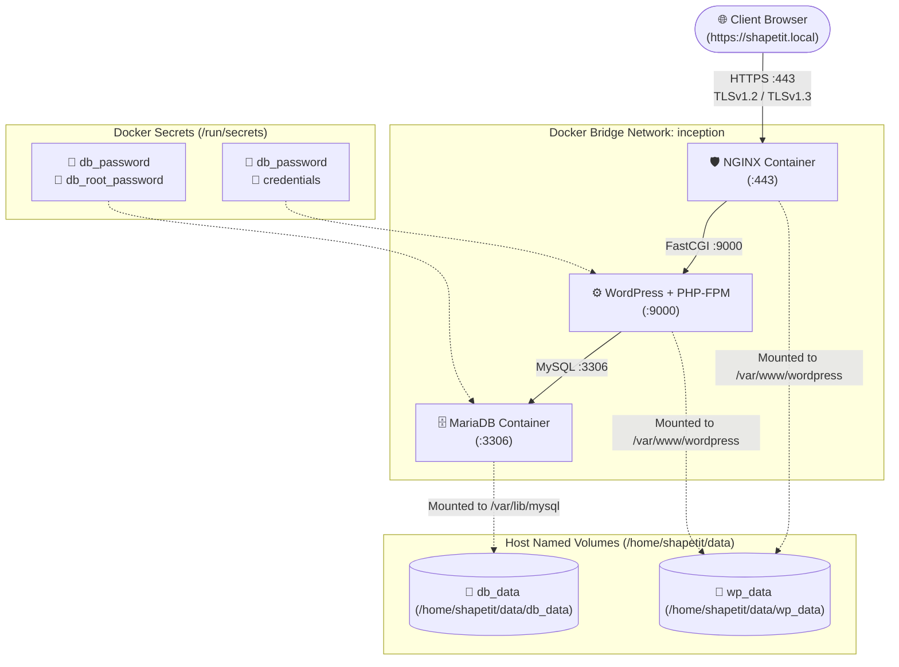

# Inception

---

## 📌 Description

### Project Overview & Goals
**Inception** is a System Administration and DevOps project. The goal is to build, configure, and orchestrate a secure, multi-service web infrastructure inside a dedicated Virtual Machine using **Docker** and **Docker Compose**.

The infrastructure hosts a dynamic **WordPress** website backed by a **MariaDB** database, served through a secure **NGINX** reverse proxy. Rather than using pre-packaged or monolithic solutions, the project enforces strict industry best practices:
- Every container image is built locally from scratch via dedicated Dockerfiles based on **Debian Bullseye** (`debian:bullseye-slim`, the penultimate stable release).
- Pulling ready-made application images or using automated DockerHub images (outside the base OS) is strictly prohibited.
- Each service runs in its own isolated container with a single primary responsibility.
- **NGINX** acts as the sole entrypoint into the infrastructure, accepting client connections exclusively over **HTTPS (TLSv1.2 or TLSv1.3)** on port `443`.
- Containers communicate through an isolated, user-defined Docker bridge network (`inception`).
- All persistent data (database records and WordPress website files) is safely preserved through Docker named volumes.
- Passwords and confidential information are protected using **Docker Secrets** mounted in-memory at runtime.

### Infrastructure Architecture



### Request and Data Flow
1. **Client Connection**: The client accesses `https://shapetit.local:443`. NGINX handles TLS termination using a self-signed TLS certificate generated via OpenSSL with strict TLSv1.2/TLSv1.3 cipher protocols.
2. **Static vs Dynamic Routing**: NGINX reads static assets directly from the shared volume `/var/www/wordpress`. Any request for PHP scripts is routed over the private `inception` network via the FastCGI protocol to `wordpress:9000`.
3. **Database Queries**: The WordPress container processes PHP requests using PHP-FPM 7.4 and communicates with the `mariadb` container on port `3306` over the private bridge network.
4. **Network Shielding**: No ports other than `443` are exposed to the host machine or public internet. MariaDB and PHP-FPM remain completely shielded behind the bridge network.

---

### Architectural Comparisons

#### 1. Virtual Machines vs Docker
| Criterion | Virtual Machines (VMs) | Docker Containers |
| :--- | :--- | :--- |
| **Architecture** | Runs on a Hypervisor (Type 1 or Type 2). Each VM contains a complete guest operating system, virtual kernel, device drivers, and binaries. | Shares the host operating system kernel. Runs isolated user-space processes utilizing Linux kernel features (`namespaces` and `cgroups`). |
| **Startup Time** | Minutes (must boot full operating system and system services). | Milliseconds to seconds (instantiates directly as native host processes). |
| **Resource Overhead** | High CPU, RAM, and disk footprint due to duplicated guest OS kernels and virtualized hardware abstractions. | Extremely lightweight; only consumes resources needed for application execution and dependencies. |
| **Isolation Level** | Hardware-level isolation enforced by the hypervisor; very strong security boundary. | Process-level isolation enforced by Linux kernel namespaces (PID, NET, IPC, MNT, UTS, USER); highly secure when non-root and least-privilege principles are followed. |
| **Project Usage** | The entire infrastructure runs inside a dedicated Linux Virtual Machine. | Inside the VM, Docker is used to orchestrate microservices without compounding hypervisor overhead. |

#### 2. Secrets vs Environment Variables
| Criterion | Environment Variables (`.env`) | Docker Secrets (`/run/secrets/`) |
| :--- | :--- | :--- |
| **Storage & Visibility** | Stored in plain text in container process environment tables. Visible via `docker inspect <container>`, `/proc/<pid>/environ`, and inherited by spawned child processes. | Stored in an in-memory virtual filesystem (`tmpfs`) at `/run/secrets/<secret_name>`. Never committed to container disk layers or image snapshots. |
| **Risk of Exposure** | High risk: often inadvertently dumped in application stack traces, crash reports, debug logs, or shell history. | Low risk: only containers explicitly granted access can read the secret file from memory with strict filesystem permissions. |
| **Access Control** | Global to the container process. | Granular: configured per service in `docker-compose.yml`. |
| **Best Practice Usage** | Non-sensitive runtime configuration parameters (e.g., `DOMAIN_NAME`, `MYSQL_DATABASE`, non-sensitive usernames). | Confidential credentials, database administrative passwords, SSL keys, and user authentication tokens. |

#### 3. Docker Network vs Host Network
| Criterion | Host Network (`network_mode: host`) | Docker Bridge Network (`inception`) |
| :--- | :--- | :--- |
| **Isolation** | No network isolation: the container shares the host machine's network stack directly. | Full network virtualization: the container receives its own network namespace, IP address, and virtual interface (`veth`). |
| **Port Conflicts** | Containers compete directly with host services and other containers for ports. | Internal ports do not conflict with host ports. Services can use default ports (e.g. `3306`, `9000`) without exposing them to the host. |
| **Service Discovery** | No automated DNS discovery; services must communicate via `localhost` or hardcoded host IPs. | Built-in Docker DNS resolver enables seamless service discovery using service names (e.g., `mariadb`, `wordpress`). |
| **Architecture Choice** | **Avoided** (`network_mode: host` and `--link` break container isolation). | **Enforced**: all containers communicate via an isolated user-defined bridge network. |

#### 4. Docker Volumes vs Bind Mounts
| Criterion | Bind Mounts (`host_path:container_path`) | Docker Named Volumes (`volume_name:container_path`) |
| :--- | :--- | :--- |
| **Management** | Tied to an arbitrary host directory. Bypasses Docker volume management subsystem; not visible in `docker volume ls`. | Managed and tracked directly by Docker (`docker volume ls`, `docker volume inspect`, `docker volume rm`). |
| **Portability & Permissions** | Heavily dependent on host directory paths and host OS permission structures; less portable across different environments. | Abstracted from host filesystem layouts; lifecycle and driver behavior are consistently managed by Docker. |
| **Storage Strategy** | Standard bind mounts are avoided for persistent data storage. | Named volumes are declared in `docker-compose.yml` and configured with driver options (`driver_opts`) to target `/home/shapetit/data`. |
| **Project Implementation** | Named volumes `db_data` and `wp_data` are declared under the top-level `volumes:` section using the `local` driver with `o: bind` options, ensuring they are registered Docker named volumes while persisting data in the host's `/home/shapetit/data`. |

---

## 📂 Repository Structure

```text
.
├── Makefile                     # Root automation script (up, down, stop, clean, fclean, re)
├── README.md                    # Main project documentation (English)
├── USER_DOC.md                  # End-user documentation (French)
├── DEV_DOC.md                   # Developer & architecture documentation (French)
├── .gitignore                   # Ignores active secrets, environment files, and build artifacts
├── secrets/                     # Directory for runtime secret files (ignored by git)
│   ├── credentials.txt.example  # Example template for WordPress credentials
│   ├── db_password.txt.example  # Example template for MySQL database password
│   └── db_root_password.txt.example # Example template for MySQL root password
└── srcs/
    ├── .env.example             # Example template for non-sensitive environment variables
    ├── docker-compose.yml       # Service orchestration, volumes, networks, and secrets definitions
    └── requirements/
        ├── mariadb/
        │   ├── Dockerfile       # Custom MariaDB image based on Debian Bullseye
        │   └── tools/
        │       ├── init.sh      # MariaDB bootstrap, root lock, and WordPress user setup script
        │       └── install.sh   # MariaDB installation package script
        ├── nginx/
        │   ├── Dockerfile       # Custom NGINX image with OpenSSL TLS certificate generation
        │   ├── conf/
        │   │   └── nginx.conf   # Virtual host configuration enforcing TLSv1.2 & TLSv1.3
        │   └── tools/
        │       └── install.sh   # NGINX package installation script
        └── wordpress/
            ├── Dockerfile       # Custom WordPress + PHP-FPM 7.4 image
            ├── conf/
            │   └── www.conf     # PHP-FPM pool configuration listening on port 9000
            └── tools/
                ├── init.sh      # WP-CLI download, DB readiness check & site installer
                └── install.sh   # PHP 7.4 & WP-CLI installation package script
```

---

## ⚙️ Services & Technical Choices

| Service | Base OS | Internal Port | Exposed Port | Purpose & Implementation Details |
| :--- | :--- | :--- | :--- | :--- |
| **`nginx`** | `debian:bullseye-slim` | `443` | `443:443` | Reverse proxy and TLS termination gateway. Configured exclusively for **TLSv1.2** and **TLSv1.3**. Generates a self-signed RSA certificate for `shapetit.local` using OpenSSL. Routes static files directly from `/var/www/wordpress` and forwards PHP requests to `wordpress:9000`. |
| **`wordpress`** | `debian:bullseye-slim` | `9000` | *None* | Runs **PHP-FPM 7.4** with WordPress core files. On startup, waits for MariaDB readiness via `mysqladmin ping`, downloads WordPress core, generates `wp-config.php`, installs the site, creates an administrator user (non-admin naming) and an author user via **WP-CLI**. Runs PHP-FPM in foreground (`php-fpm7.4 -F`). |
| **`mariadb`** | `debian:bullseye-slim` | `3306` | *None* | Relational database server. Initializes system databases, creates the `wordpress` database, creates dedicated WordPress user and root user with passwords read from `/run/secrets/`, removes anonymous users, flushes privileges, and replaces process with `exec mysqld --user=mysql`. |

### Key Design Principles:
- **No Infinite Loops / Hacky Patches**: No containers rely on `tail -f`, `sleep infinity`, or `while true` loops. Daemons run in foreground (`nginx -g 'daemon off;'`, `php-fpm7.4 -F`, `exec mysqld --user=mysql`) to properly handle **PID 1** signals.
- **Restart Policy**: All services specify `restart: always` to recover automatically from unexpected crashes.
- **Administrator Username Restriction**: The WordPress administrator username is configured as `shapetit_wp`, strictly avoiding generic terms such as `admin`, `Admin`, `administrator`, or `Administrator`.

---

## 🚀 Instructions

### 1. Prerequisites
- **Operating System**: Linux (Debian, Ubuntu, or Linux Virtual Machine) or macOS with Docker support.
- **Docker Engine**: Version `>= 20.10`
- **Docker Compose**: Version `>= 2.0` (or `docker-compose` v1)
- **Make**: Standard GNU Make build utility.
- **Root/Sudo Access**: Required to configure `/etc/hosts` and create persistent host directories in `/home/shapetit/data`.

### 2. Local Domain Setup
The infrastructure is configured to serve under domain `shapetit.local`. Map this domain to your local IP (`127.0.0.1`) in `/etc/hosts`:

```bash
sudo sh -c 'echo "127.0.0.1 shapetit.local" >> /etc/hosts'
```

### 3. Environment & Secrets Configuration
The repository includes example templates that must be copied into active configuration files:

```bash
# 1. Non-sensitive environment variables
cp srcs/.env.example srcs/.env

# 2. Database and WordPress secrets
cp secrets/credentials.txt.example secrets/credentials.txt
cp secrets/db_password.txt.example secrets/db_password.txt
cp secrets/db_root_password.txt.example secrets/db_root_password.txt
```

> [!IMPORTANT]
> - Edit `srcs/.env` and `secrets/*.txt` with strong, custom credentials before launching.
> - Secrets files and `.env` are excluded by `.gitignore` to prevent any credentials from being committed to Git.

### 4. Build and Launch
From the root of the repository, execute:

```bash
make
```
*(or `make up`)*

This automated workflow will:
1. Create the persistent host storage directories `/home/shapetit/data/db_data` and `/home/shapetit/data/wp_data`.
2. Build each custom Docker image locally (`nginx:inception`, `wordpress:inception`, `mariadb:inception`).
3. Connect the containers to the `inception` bridge network.
4. Mount the Docker secrets into `/run/secrets/` in container memory.
5. Start the full infrastructure in detached mode (`-d`).

---

## 🛠️ Makefile Commands

| Command | Action | Data Preservation |
| :--- | :--- | :--- |
| `make` / `make up` | Creates host storage directories, builds images, and starts containers in detached mode. | Preserved |
| `make stop` | Stops running containers without removing them (`docker-compose stop`). | Preserved |
| `make down` | Stops and removes containers and the Docker bridge network (`docker-compose down`). | Preserved |
| `make clean` | Executes `down` and deletes built Docker images (`docker-compose down --rmi all`). | Preserved |
| `make fclean` | Executes `clean` and **purges all persistent data** from `/home/shapetit/data` (`sudo rm -rf`). | **Deleted** |
| `make re` | Performs a clean rebuild from scratch (`fclean` followed by `all`). | Reset |

---

## 🔍 Verification & Testing

### 1. Check Container Health
Verify that all three services are running:
```bash
docker ps
```
*Expected output: Three containers (`nginx`, `wordpress`, `mariadb`) with status `Up`.*

### 2. Inspect Service Logs
```bash
# NGINX reverse proxy logs
docker logs -f nginx

# WordPress and PHP-FPM initialization logs
docker logs -f wordpress

# MariaDB database bootstrap logs
docker logs -f mariadb
```

### 3. Test TLS Security Protocols
Verify that NGINX strictly accepts TLSv1.2 and TLSv1.3 and rejects older, insecure protocols:

```bash
# Should connect successfully (TLS 1.2 & 1.3 supported):
openssl s_client -connect shapetit.local:443 -tls1_2
openssl s_client -connect shapetit.local:443 -tls1_3

# Should fail / handshake error (TLS 1.0 & 1.1 rejected):
openssl s_client -connect shapetit.local:443 -tls1
openssl s_client -connect shapetit.local:443 -tls1_1
```

### 4. Verify Data Persistence
Test that data survives container recreation:
1. Connect to `https://shapetit.local` in your browser.
2. Log in to the WordPress administration panel at `https://shapetit.local/wp-admin` using credentials from `secrets/credentials.txt`.
3. Create a test blog post or comment.
4. Stop and remove the containers:
   ```bash
   make down
   ```
5. Restart the containers:
   ```bash
   make up
   ```
6. Refresh the page: the post and all database modifications remain intact because data is persisted in `/home/shapetit/data/`.

### 5. Verify Secrets Isolation
Confirm that secrets are mounted in memory and not leaked to environment variables:
```bash
# Verify secret files inside container:
docker exec -it wordpress ls -l /run/secrets/

# Verify that passwords are NOT listed in environment:
docker exec -it wordpress env | grep -i pass
docker exec -it mariadb env | grep -i pass
```

---

## 📚 Resources

### References & Documentation
- [Docker Engine Overview](https://docs.docker.com/get-started/overview/) — Official Docker architecture documentation and container concepts.
- [Docker Compose Specification](https://docs.docker.com/compose/compose-file/) — Syntax, networking, secrets, and volume configuration reference.
- [NGINX SSL/TLS Termination](https://nginx.org/en/docs/http/configuring_https_servers.html) — Configuring HTTPS, SSL certificates, and TLS protocols.
- [NGINX FastCGI Proxying](https://nginx.org/en/docs/http/ngx_http_fastcgi_module.html) — Interfacing NGINX with PHP-FPM FastCGI pools.
- [WP-CLI Command Reference](https://developer.wordpress.org/cli/commands/) — Automating WordPress core downloads, configuration, and user creation.
- [MariaDB Knowledge Base](https://mariadb.com/kb/en/documentation/) — MariaDB database initialization, user privileges, and server administration.
- [Debian Bullseye Documentation](https://www.debian.org/releases/bullseye/) — Package management and configuration in Debian base images.

### AI Usage Description
Artificial intelligence tools were utilized during the development of this project as follows:
- **Conceptual Clarification & Research**: AI was consulted to cross-reference Docker best practices regarding PID 1 signal propagation, the trade-offs of daemonization vs foreground execution (`php-fpm -F`, `nginx -g 'daemon off;'`), and differences between Docker named volumes with bind driver options vs standard host bind mounts.
- **Script Review & Edge-Case Identification**: AI was used to review bash initialization scripts (`init.sh` for MariaDB and WordPress), identifying edge cases such as database readiness polling (`mysqladmin ping`) before executing WP-CLI commands and ensuring secure password piping without plain-text exposure in logs.
- **Documentation Structuring & Formatting**: AI assisted in formatting markdown documentation, creating Mermaid architecture diagrams, and verifying that all architectural and security requirements were addressed.
- **Human Verification & Validation**: Every line of configuration, Dockerfile instruction, and shell script was reviewed, tested, and validated manually within the virtual machine to ensure complete understanding, reliability, and security.

---

## 📖 Additional Project Documentation

- [USER_DOC.md](./USER_DOC.md) — End-user guide explaining how to start, stop, access, and verify the stack.
- [DEV_DOC.md](./DEV_DOC.md) — Comprehensive developer documentation detailing container startup scripts, network topologies, and volume persistence.

---

## 👤 Author

- **Author**: `shapetit`
